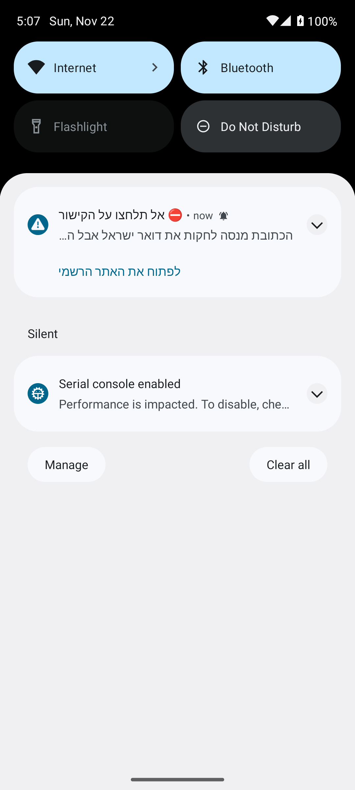

# Shomer — checks a message against the official site, and warns before you tap

A message arrives: *"Israel Post: your parcel is on hold, confirm your address"* with a link. Is it real?

Shomer is a background checker for older adults in Israel. It does not guess with a generic classifier: it **compares the link with the official domain of the organization the message claims to be from**, looks at what the message asks for (hurry, a threat, card details, a payment, a "family member" asking for money), and raises a warning in plain Hebrew by itself, without the app being opened. It **never says a message is safe**.

<p align="center"></p>

*The notification above is real output: an Android 13 emulator in CI received a fake scam SMS and Shomer raised it ([evidence](docs/proof/)).*

**Try it:** [live demo](https://danielleavidor.github.io/shomer/) (a phone lock screen that checks sample messages; the static copy checks only the examples) · [product requirements](docs/PRD.md) · [what the five reviewers rejected](docs/reviews/)

> **Status:** the engine, the 11 verified directory entries, the Hebrew web demo and the tests run; the Android app builds and passes its unit tests in CI, and on an emulator in CI a scam SMS raises one alert and an ordinary message raises none. It has **not** run on a physical phone: the first real phone blocked the install. There is no real-user data beyond three oral interviews in one family.

## Three outcomes, never "safe"

| Outcome | Shown as | When |
|---|---|---|
| Don't click | **אל תלחצו** | The link is a lookalike or does not match the organization named (`israelpost.co.il.pay-now.top`, `@` tricks, punycode, raw IPs, a Cyrillic letter in a domain, odd or hidden characters), or the message pushes without a link |
| Official address, not a confirmation | **הכתובת היא של האתר הרשמי, אבל זה לא אישור להודעה** | The link is on a verified official domain and the message does not pressure, ask for details, payment or a call. It still says: open the app or site yourself |
| Could not check | **לא הצלחנו לבדוק** | Unknown organization, a shortened link, an unverified directory entry, an official link with a redirect, or nothing to check. Don't click, ask someone |

An alert is raised on its own only when there is a reason: for SMS on "don't click" and on "could not check" when the message names a known organization or a link comes with a push; in chat apps only on a high-confidence "don't click" (people share links all the time). Never on the official-address outcome.

## What is proven, and how you can check it

| Claim | How it is checked | Where |
|---|---|---|
| The engine returns the right outcome on lookalikes, redirects, path tricks, hidden characters, spread-out and fullwidth letters | 160 Python tests plus a 55-message corpus (36 scams, 19 legitimate), run on every push | `tests/`, `eval/`, workflow *Tests* |
| Scams are never reported as "official address" | Corpus: 0 of 36. Hard "don't click": 25 of 36; the rest are "could not check" | `python eval/run_eval.py` |
| The Android engine behaves like the Python engine | The Kotlin file is compiled on a plain JVM and run on 490 messages: 0 differences | `tools/kotlin-parity/`, workflow *Tests* |
| The Android app builds and its unit tests pass | GitHub Actions | workflow *Android debug APK* |
| On Android, the background agent alerts without the app being opened, and stays quiet on an ordinary message | An emulator in CI receives a fake SMS; the job fails unless exactly one alert appears; screenshots, a recording and the notification text are saved | `docs/proof/`, workflow *Android on an emulator* |
| The message text is not stored | A test reads the database columns; the Android history stores only the app, the time and Shomer's own explanation | `tests/test_server.py`, `History.kt` |

Running the app on an emulator found two crashes that the unit tests could not see (Android's regular expressions are stricter than the JVM's).

## Try it yourself

```bash
python -m shomer.server        # then open http://localhost:8000  (Python 3.10+, standard library only)
python -m pytest
python eval/run_eval.py
```

**Android:** every push that touches `app/` builds a debug APK in GitHub Actions (*Actions*, the latest green run, artifact `shomer-debug-apk`; downloading needs a GitHub login). Read the limits below before installing it.

## Limits, in one place

- **Not run on a physical phone, and installing it may not work.** The first real phone (a Google phone) refused the APK with Play Protect's "App blocked to protect your device", and the install still failed after Play Protect scanning was switched off. An app outside the Play Store that reads SMS or notifications may not be installable on current phones, and Google Play restricts SMS permissions to default SMS apps. A public release needs another route; until one is proven, v1 may be paste and share. See PRD section 9.
- **Accuracy on real messages is unknown.** The corpus was written by the same person who wrote the rules, partly after reviews, so it guards against regressions; it is not an accuracy estimate. 0 misses in 36 scams is still consistent with a true miss rate of roughly 8%.
- **Friction.** 7 of 12 legitimate messages that have a link or a named organization still end as "could not check", and 4 of 19 legitimate messages raise an SMS alert.
- **User evidence is thin.** Three oral interviews in one family. Simulated reviews (designer, hiring manager, product critic, security engineer, QA, simulated users) are role-play by an AI: they find bugs and weak claims, they are not user research.
- **Directory:** 11 of 16 entries verified (checked 2026-11-21 against the organizations' own pages, IEC from company statements quoted in the press). Kvish 6, Bit, PayPal, the Tax Authority and the Home Front Command are not verified. Entries carry no per-entry source URL yet.
- **Open evasions** (PRD section 20): scams with no link (callback numbers, QR codes), shorteners (the destination is not followed), organizations not in the directory, leetspeak.
- iPhone cannot read other apps' messages, so there it would be paste and share only.

## Who decided what

I chose the problem and the user (relatives who get these messages and often click first), ran the three interviews, and set the rules the product holds to: it never says "safe", it always points to the official route, it speaks up only when there is a reason, and family alerts are opt-in. I rejected an agent that signs in to people's accounts. When the first demo needed the app to be opened to show a warning, I sent it back: the point is a warning without opening anything, which is why the demo is a lock screen. I asked for a real working app and for proof that it runs.

Claude (an AI assistant) wrote the code, the tests, the CI and first drafts of the documents under that direction, and ran the reviewer agents. In the commit history, commits by `Claude` are the AI's own; the two of us changed each other's work throughout.

## Repository map

| Path | What |
|---|---|
| `docs/PRD.md` | Problem, users, positioning, scope, decision logic, metrics, validation plan, risks, threat model |
| `docs/reviews/` | The five role-play reviews of the third round (QA, product, hiring manager, security, design) |
| `docs/proof/` | Emulator screenshots, recording and notification text from the last green run |
| `docs/index.html` | Static demo for GitHub Pages, built by `tools/build_demo.py` from the real engine |
| `docs/research/` | Interview notes (three people, one family) |
| `shomer/` | Python engine, directory (`data/directory.json`), local demo server and Hebrew UI |
| `app/` | Android app (Kotlin): SMS receiver, notification listener, alerts, history, share target |
| `eval/` | Corpus and evaluation script |
| `tools/` | Kotlin-vs-Python parity check, emulator test, demo builder |
| `survey/` | A short Hebrew survey for older adults and relatives, not yet used |
| `.github/workflows/` | *Tests*, *Android debug APK*, *Android on an emulator* |

## What I cut, and why

An AI model deciding verdicts (a rule engine gives the same answer for the same input and can be explained); an agent that signs in to accounts; iPhone background checking (not possible); reading WhatsApp in full (notifications only, from a short list of apps); a score or a "safe" badge (it would invite trust the tool has not earned); unverified organizations as "official" (they stay "could not check"; related domains that are probably but not provably the organization's are kept as `unconfirmed_domains`).

## Next steps

1. Install the APK on a physical phone, or prove another route (PRD section 9).
2. Run the one-week test in PRD section 8: five older adults, three outside the family, installing alone.
3. Add a source URL to each directory entry and verify Kvish 6, Bit and the Home Front Command.
4. Collect 10 to 20 real, consented messages and measure against the PRD targets.
